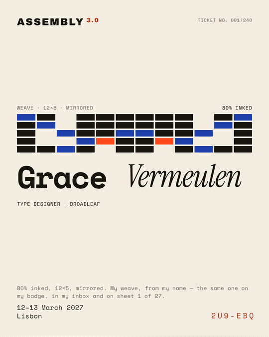
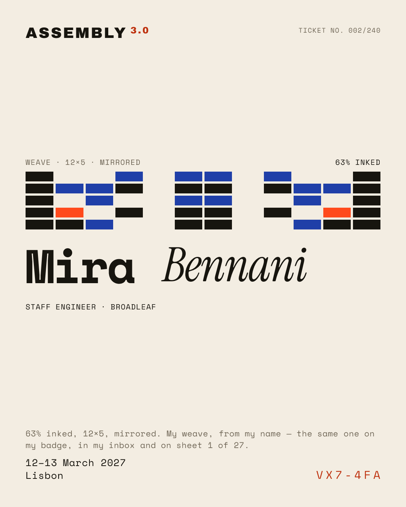
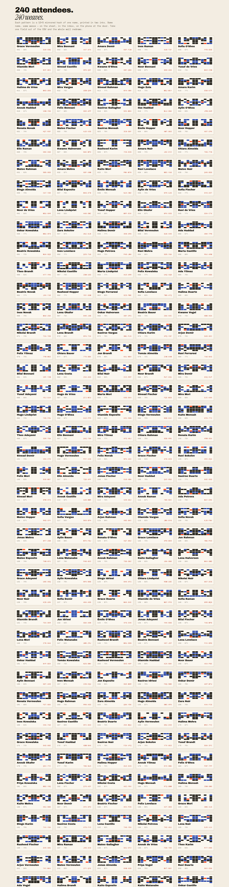

# Roll Call

**One CSV of attendees in. A whole badge run out — print sheets, welcome emails, badge pages and story cards — all from one Hyper Elements theme.**



Every badge carries a **weave**: a 12×5 mirrored pattern hashed from the attendee's
name. Two inks, one accent, no two alike. It is the same pattern on the printed
sheet, in the inbox, on the phone at the door and in the story card, because it is
the same component rendering to four destinations.

The demo run: **240 attendees → 240 distinct weaves, 0 collisions → 240 emails,
240 badge pages, 240 story cards, 27 print sheets, 1 wall.** Every one validated
before it was written.



---

## Why a badge kit

Event badges are the one document where a template has to do all four jobs at
once — get printed on dead trees, get emailed to 240 people, get opened on a phone
in a queue, and get posted afterwards. Everyone solves it with four unrelated
tools and a spreadsheet, and the four versions drift apart.

One data file fixes that, but only if the *badge itself* — the art, the name, the
code, the number — is one set of components. That is the whole idea:

| Output | What it is | Hyper Elements root |
| --- | --- | --- |
| `dist/sheets/sheet-01.pdf` … | Nine 85×54mm badges imposed on A4 landscape, dashed cut lines, short last sheet | `Document` → `renderPdf()` |
| `dist/email/<name>.html` + `.txt` | The welcome email, badge drawn with tables, no images, no web fonts | `Email` → `render()` |
| `dist/pages/<name>.html` | The badge page they open at the door: phone-first, 78px name | `Page` → `render()` |
| `dist/cards/<name>.png` | The 1080×1350 story card | `Canvas` → `renderImage()` |
| `dist/wall.html` | All 240 badges on one page | `Page` |


## The weave is the point

```ts
export function weave(name: string): Inks[]   // 12 columns × 5 rows, mirrored
```

- **Deterministic.** FNV-1a over the normalised name, sliced per row. Same name,
  same weave, forever — `--limit 24` produces byte-identical cards to the full run.
- **Mirrored, not random.** Six free cells per row, reflected to twelve, one
  inked frame cell at each edge and one accent per attendee. Mirrored patterns
  read as designed; noise reads as a bug.
- **Visible in every destination.** It is built from a `Grid` of `Column`s with a
  background colour — *not* an `Svg`. An `Email` cannot hold an `Svg`, and the
  badge in the email has to be the same badge. The rules are printed on the thing
  itself (`WEAVE · 12×5 · MIRRORED` / `80% INKED`) so the pattern stops being
  texture and becomes a stated system.
- **Audited in the run.** `checks.json` and `manifest.json` record every pattern;
  the engine fails the run if two names ever produce one weave.



## How Hyper Elements is used

This is not four templates with a shared palette. It is one engine doing the work
the library was built for:

- **One `defineTheme()`** (`src/theme.ts`) for all four roots: colour roles, a
  three-step heading scale, a `badge` named style, a `stamp` style, and per-element
  defaults. Change `paper.stock` and every email, page, PDF and PNG follows.
- **Shared components across roots** (`src/components.tsx`: `Weave`, `WeaveSpec`,
  `Wordmark`, `Stamp`) — the reason the printed badge and the emailed badge are the
  same badge.
- **`Document` as a real imposition**: `orientation="landscape"`, `margin` in
  insets, a `Grid` of three, `PageFooter` with `<PageNumber />` and
  `<PageNumber total />`, and 240 attendees chunked into 27 sheets of nine with a
  deliberately short last sheet (6 badges, not 9 with a ghost).
- **`renderPdf()` and `renderImage()` on the server**: no browser, no screenshot
  service, no network. 240 cards are 240 renders, not 240 tabs. Font bytes go in
  through the `fonts` option (TTF/OTF/WOFF — WOFF2 is not drawn).
- **`validate()` as a gate, not a linter someone remembers to run.** Before the
  first email is written, a sample of each output runs `validate()` with the
  `lint()` plugin *and* `emailClients()`. An error stops the run; 240 versions of
  one mistake never reach disk.
- **`@hyper-elements/email-clients` for the client proof**
  (`npm run clients` → `docs/clients/*.png`): the same email previewed as classic
  Outlook, Gmail and Apple Mail draw it. Result: **5 previews, 2 degradations** —
  a button's `borderRadius` goes square in Outlook, and `hover` doesn't fire. No
  web fonts, no images and no reliance on `justifyContent`, so nothing else moved.
- **`@hyper-elements/cli` in the agent loop**: `templates/` holds one module per
  output with a default-exported component, so
  `npx hyper-elements check templates/` reports **5 templates: 0 errors, 0
  warnings, 0 skipped**.
- **Written for agents too** (`AGENTS.md`): the invariants an agent must not
  break, the exact failures that produced them, and where to read the shipped
  `GUIDE.md` first.

### What the loop actually caught

The engine's diagnostics did the work. In order:

1. `jsx/markup` — `<br/>` inside `Text` and `Heading`: replaced with `<LineBreak />`.
2. `style/unknown` — `marginTop` on a `Text`: spacing moved to the parent's `gap`.
3. `style/invalid` — `alignItems: "flex-start"` isn't a value: `"start"`.
4. `email/unsupported` — `justifyContent: "space-between"` in an email: classic
   Outlook starts every child at the left. Rebuilt as `flex: 1` + a fixed-width
   right column.
5. `email/lint-contrast` — the accent ink was **2.88:1** on paper. Added
   `paper.redInk` (`#BE320F`, 4.9:1) for text and kept the bright `#FF4A1C` for
   shapes only. Gate now reports **0 warnings**.
6. `image/font-weight` / `pdf/font-weight` — Archivo Black declared at one weight,
   asked for another: declared at 400 and 700, and the real italic serif file added
   instead of a synthesised slant.
7. **One the engine could not catch**: `№` rendered as a tofu box in the story card,
   because Space Mono has no such glyph. It showed up in a screenshot review, not in
   a diagnostic. Every `No.` in this repo is that bug fixed.

## Run it

```bash
git clone https://github.com/memeshee/roll-call && cd roll-call
npm install

npm run check                 # the gate: validate every template in templates/
npm run make -- --limit 24    # a small run into dist/ (~15s)
npm run make                  # the full run: 240 attendees, 27 sheets (~2m30s)
npm run clients               # Outlook / Gmail / Apple Mail previews
npm run shots                 # regenerate every image in docs/ (needs google-chrome + poppler)
```

Node 22+.

```bash
# bring your own roster: name,email,role,org,ticket
npm run make -- --in data/my-event.csv --out out --limit 40
```

`--only email,page,card,sheets,wall` renders one output, `--scale 2` doubles the
PNGs. Nothing else needs changing: the sheet count, the `No. NNN/total` numbering
and the short last sheet all follow from the file.

### Don't want to run anything?

`examples/` holds one of each artifact from the demo run — the welcome email
(HTML and plain text), the badge page, the story card PNG, sheet 1 as a PDF, plus
`checks.json` and `manifest.json`.

## What it produces, measured

```
240 attendees · 240 emails · 240 pages · 240 cards · 27 PDFs · 1 wall · 27 sheets of 9
weaves: 240 distinct, 0 collisions
diagnostics: 0 errors, 0 kinds of warning, 4 notes → dist/checks.json
145.7s
```

The 4 remaining notes are `lint/text-size`: 11px mono captions, which are a
deliberate part of the print language. They are informational, and the run prints
them rather than hiding them.

## Printing

A4 landscape, 85×54mm badges (credit-card size, the standard badge stock), 3×3 per
sheet, 8mm gutters, a dashed hairline around each badge as the cut guide, and a
footer on every sheet with the sheet number and the total. `pdfinfo` on a sheet:
`841.89 × 595.275 pts`, one page. 240 attendees → 27 sheets, the 27th holding 6.

## Repo map

```
src/
  theme.ts        the brand, once: colours, type scale, named styles
  weave.ts        the deterministic pattern and the code printed on the badge
  components.tsx  Weave, WeaveSpec, Wordmark, Stamp — shared by every root
  sheet.tsx       Document: the A4 imposition
  badge-email.tsx Email: the welcome email, no images, no web fonts
  badge-page.tsx  Page: what they open at the door
  card.tsx        Canvas: the story card
  wall.tsx        Page: all 240 badges
  fonts.ts        bytes for PDF/PNG, relative URLs for pages
scripts/
  make.tsx        the batch engine and its gate
  clients.tsx     the email-client proof
  gen-people.ts   the fictional roster, generated reproducibly
  shots.sh        regenerate everything in docs/
templates/        one default-exported component per output, for `hyper-elements check`
data/             assembly-attendees.csv — 240 fictional attendees
docs/             the images in this README, all produced by the run
examples/         one artifact of each kind, for reviewers
AGENTS.md         the invariants an agent must not break
```

## Honest limits

- **Assembly 3.0 is fictional**, and so are the 240 attendees; the CSV is a normal
  registration export, which is the point.
- **`@media` doesn't exist in classic Outlook**, so a phone reading that client gets
  the desktop layout. Phone stacking is set through the engine's `mobile` styles and
  is real everywhere else.
- **Letter-spacing is not drawn in classic Outlook** (the CLI reports it per element);
  the mono captions fall back to normal spacing there. Nothing breaks, it just gets
  tighter.
- **`renderImage()` needs `satori` + `@resvg/resvg-js`, and `renderPdf()` needs
  `@react-pdf/renderer`** — all three are optional peers of the engine, listed in
  `package.json` because this kit uses them.
- **The story card is 1080×1350 at `--scale 1`** by default; `--scale 2` doubles it
  for print-quality posts.

## Fonts

Archivo Black, Space Mono and Instrument Serif (SIL Open Font License), fetched from
Google Fonts via `gwfh.mranftl.com` and committed so the run is reproducible. The
email does not load them — it names stacks that fall back to Arial Black / Courier
New / Georgia, because a template that needs a webfont to look right isn't an email
template.

## Built for

The [Hyper Elements Template Challenge](https://github.com/hyper-elements/hyper-elements/discussions/categories/challenge-submissions),
November 2026. MIT licensed.
