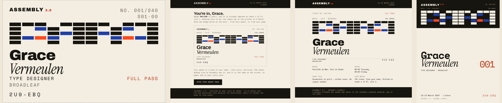
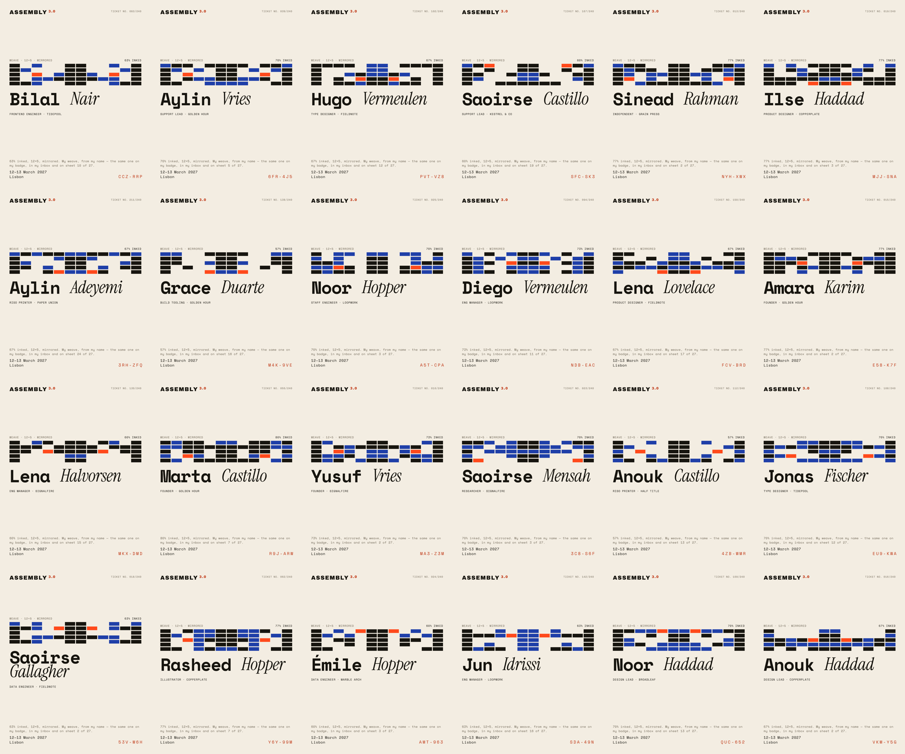
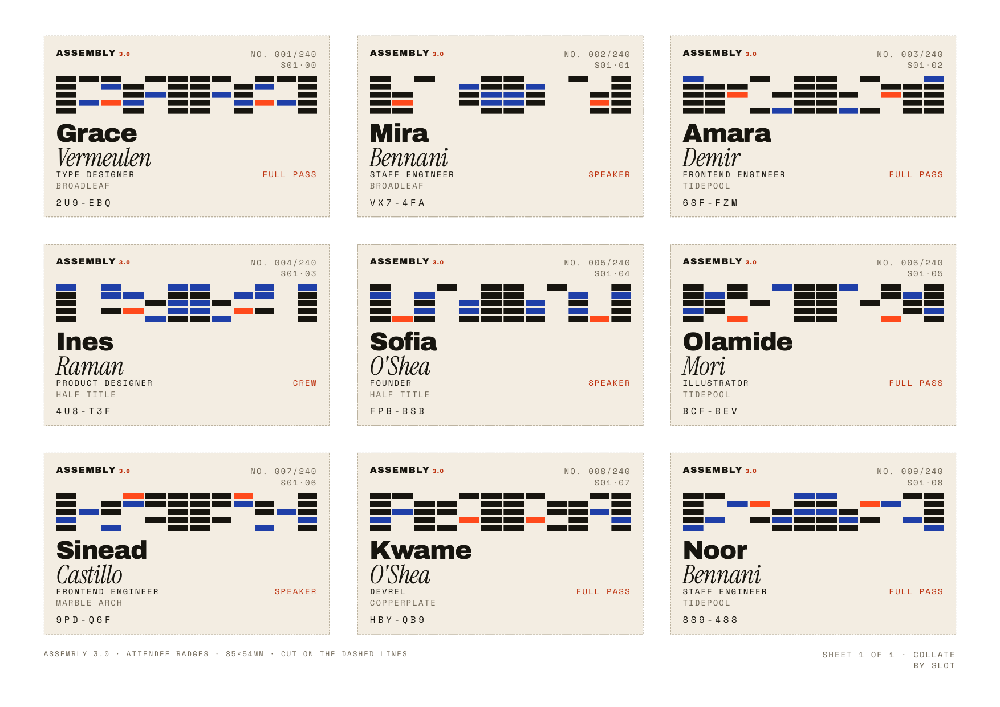
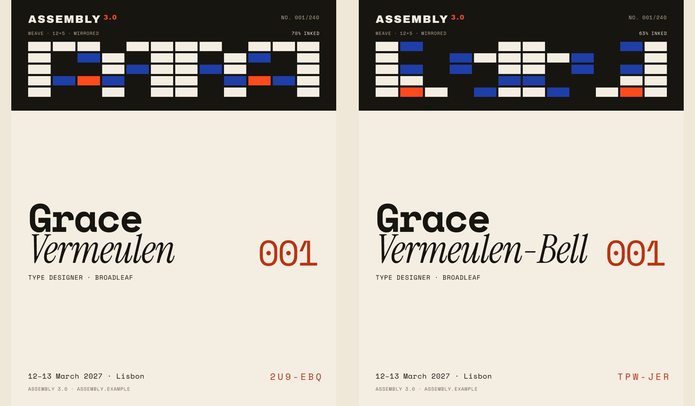
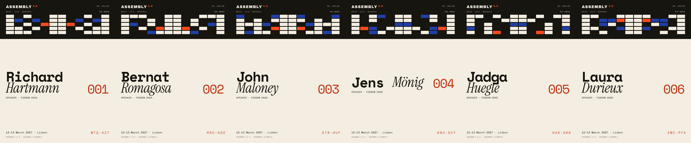

# Roll Call

**One CSV of attendees in. A whole badge run out — print sheets, welcome emails, badge pages and story cards — from one Hyper Elements theme.**



Same person, four destinations, one component tree. The pattern on every badge is a
**weave**: a 12×5 mirrored hash of the attendee's name. Two inks and one accent, no two
alike, and identical in all four places because it is literally the same component
rendered by four different roots.

**240 attendees → 240 distinct weaves, 0 collisions → 240 emails, 240 badge pages, 240
story cards, 27 print sheets. 136.8 seconds, 0 errors, 0 warnings.**



---

## Why a badge kit

A badge is the one document that has to do four jobs at once: get **printed** on card
stock, get **emailed** to 240 people, get **opened on a phone** in a queue with no
signal, and get **posted** afterwards. Everyone solves it with four unrelated tools and
a spreadsheet, and the four versions drift apart.

One data file fixes the data. It does not fix the badge — unless the badge itself is one
set of components. That is the whole idea, and it is why the art is built from layout
primitives rather than an `Svg`: an `Email` cannot hold an `Svg`, and the badge in the
email has to be the badge on the sheet.

Each destination is then given a job the others cannot do:

| Destination | Its one job | What only it has |
| --- | --- | --- |
| **Print sheet** (`Document` → `renderPdf()`) | Be the physical badge | 3×3 imposition on A4 landscape, 8mm gutters, dashed cut lines, a collation marker (`S03·07`) on every badge, a footer naming the sheet |
| **Welcome email** (`Email`) | Reach 240 inboxes intact | Drawn with tables, no images, no web fonts, no `justifyContent` — an attendee who blocks remote images still sees their own badge and name |
| **Badge page** (`Page`) | Work at the door, in bad light, with no signal | A 78px name, the code, and which sheet and slot the physical badge is on |
| **Story card** (`Canvas` → `renderImage()`) | Be posted | A 1080×1350 PNG plus a plain-text caption written beside it, so posting is one paste |



## The weave, and its quality floor

```ts
export function weave(name: string): Inks[]      // 12 columns × 5 rows, mirrored
export function assertWeave(name: string): void  // the floor, enforced
```

- **Deterministic.** FNV-1a over the normalised name. Same name, same weave, forever:
  `--limit 24` produces byte-identical cards to the full run.
- **Mirrored, not random.** Six free cells per row, reflected to twelve, an inked frame
  cell at each edge, exactly one accent. Mirrored patterns read as designed; noise reads
  as a bug.
- **Constrained on purpose.** Two or three filled cells per row, redrawn with a salted
  word if a row comes out solid, empty or identical to the one above it. Ink lands in a
  **50–77% band (mean 63%)** across the roster, so nobody gets the ugly badge.
  `assertWeave()` runs over every name before anything renders and the batch **throws
  instead of printing** a degenerate pattern. 21 of 240 names failed the first version
  of that check — which is exactly what it is for.
- **Visible in the destination.** The same component on paper stock and knocked out of
  an ink band (`tone="ink"`), so the story card gets the pattern as a poster instead of
  a swatch.
- **Audited in the run.** `manifest.json` records every pattern and `checks.json` the
  gate's verdict; the run fails if two names ever produce one weave.

## Changing one field redraws everything



Every badge run has a corrections pass after the first proof. This is not a re-run — 240
badges are already on card stock:

```
$ npx tsx scripts/corrections.tsx
applying 3 corrections to 240 attendees

  No. 001  Grace Vermeulen → Grace Vermeulen-Bell
          code 2U9-EBQ → TPW-JER, sheet 1 slot 1
  No. 002  Mira Bennani → Mira Bennani
          code VX7-4FA → VX7-4FA, sheet 1 slot 2
  No. 241  added Ada Lovelace
          code 23E-S5W → 23E-S5W, sheet 27 slot 7

3 badges rebuilt, 2 sheets reprinted (01, 27) out of 27. Everything else stays as printed.
```

A new name means a new weave means a new code: `Grace Vermeulen-Bell` is a different
person to the hash, so her pattern changes and her old card is stale. Nothing else moves
— every other badge keeps its number, its slot and its sheet.

## Real data, not just the demo

The 240-attendee roster is fictional (Assembly 3.0 is an invented conference), so the kit
was also run against a real public roster: **96 speakers from the FOSDEM 2025 public
schedule**, taken from `fosdem.org/2025/schedule/xml`.



```
$ npx tsx scripts/make.tsx --in data/fosdem-2025-speakers.csv --out dist-fosdem
96 attendees · 96 emails · 96 pages · 96 cards · 11 PDFs · 11 sheets of 9
weaves: 96 distinct, 0 collisions · 0 errors, 0 kinds of warning · 68.2s
```

Real names expose what invented ones hide: apostrophes, accents, double-barrelled
surnames, three-part names, and a few names that hash to awkward patterns — the last
group is what the invariants caught. Speaker names are used for a badge layout only; no
affiliation or biography is implied.

## How Hyper Elements is used

- **One `defineTheme()`** (`src/theme.ts`) for all four roots: colour roles, a three-step
  heading scale, `badge` and `stamp` named styles, per-element defaults. Change
  `paper.stock` and every email, page, PDF and PNG follows.
- **Shared components across roots** (`Weave`, `WeaveSpec`, `Wordmark`, `Stamp`) — the
  reason the printed badge and the emailed badge are the same badge.
- **`Document` as a real imposition**: `orientation="landscape"`, `margin` insets, a
  `Grid` of three, `PageFooter` with `<PageNumber />` and `<PageNumber total />`, a
  collation marker per slot, and a deliberately short last sheet (6 badges, not 9 with a
  ghost).
- **`renderPdf()` and `renderImage()` on the server**: no browser, no screenshot
  service, no network. 240 cards are 240 renders, not 240 tabs. Font bytes go in through
  the `fonts` option.
- **`validate()` as a gate, not a linter someone remembers to run.** Before the first
  email is written, a sample of each output runs `validate()` with the `lint()` plugin
  *and* `emailClients()`. An error stops the run — 240 versions of one mistake never
  reach disk — and `checks.json` makes the gate's verdict a file rather than a claim.
- **`@hyper-elements/email-clients` for the client proof** (`npm run clients` →
  `docs/clients/*.png`): the same email previewed as classic Outlook, Gmail and Apple
  Mail draw it. Result: **5 previews, 2 degradations** — a button's `borderRadius` goes
  square in Outlook, and `hover` doesn't fire. No web fonts, no images and no reliance on
  `justifyContent`, so nothing else moved.
- **`@hyper-elements/cli` in the loop**: `templates/` holds one default-exported
  component per output, so `npx hyper-elements check templates/` reports **4 templates:
  0 errors, 0 warnings, 0 skipped**.
- **Written for agents** (`AGENTS.md`): the invariants an agent must not break, the exact
  failure that produced each one, and the instruction to read the shipped `GUIDE.md`
  first.

### What the loop actually caught

1. `jsx/markup` — `<br/>` inside `Text`/`Heading`: replaced with `<LineBreak />`.
2. `style/unknown` — `marginTop` on a `Text`: spacing moved to the parent's `gap`.
3. `style/invalid` — `alignItems: "flex-start"` isn't a value: `"start"`.
4. `email/unsupported` — `justifyContent: "space-between"` in an email: classic Outlook
   starts every child at the left. Rebuilt as `flex: 1` + a fixed-width right column.
5. `email/lint-contrast` — the accent ink was **2.88:1** on paper. Added `paper.redInk`
   (`#BE320F`, 4.9:1) for text and kept `#FF4A1C` for shapes only. The gate is now 0
   warnings.
6. `image/font-weight` / `pdf/font-weight` — Archivo Black declared at one weight, asked
   for another: declared at 400 and 700, and the real italic serif file added instead of
   a synthesised slant.
7. **One the engine could not catch**: `№` rendered as a tofu box in the story card,
   because Space Mono has no such glyph. It turned up in a screenshot review, not in a
   diagnostic. Every `No.` in this repo is that bug fixed.
8. **One the gate could not catch**: the first unconstrained weave produced solid rows
   and twin rows. Uniqueness was fine; quality was not. Hence `assertWeave()`.

## Run it

```bash
git clone https://github.com/memeshee/roll-call && cd roll-call
npm install

npm run check                    # the gate: validate every template
npm run make -- --limit 24       # a small run into dist/ (~16s)
npm run make                     # the full run: 240 attendees, 27 sheets (~2m20s)
npm run corrections              # the corrections pass against data/corrections.json
npm run clients                  # Outlook / Gmail / Apple Mail previews
npm run shots                    # regenerate every image in docs/
```

Node 22+.

```bash
# bring your own roster: name,email,role,org,ticket
npm run make -- --in data/my-event.csv --out out
```

`--only email,page,card,sheets` renders one output; `--scale 2` doubles the PNGs. The
sheet count, the `No. NNN/total` numbering, the collation markers and the short last
sheet all follow from the file.

### Don't want to run anything?

`examples/` holds one of each artifact from the demo run — the welcome email (HTML and
plain text), the badge page, the story card PNG, sheet 1 as a PDF, the corrections
outputs, plus `checks.json` and `manifest.json`.

## What it produces, measured

```
240 attendees · 240 emails · 240 pages · 240 cards · 27 PDFs · 27 sheets of 9
weaves: 240 distinct, 0 collisions
diagnostics: 0 errors, 0 kinds of warning, 5 notes → dist/checks.json
136.8s
```

The remaining notes are `lint/text-size` (11px mono captions, a deliberate part of the
print language) and the two client degradations above. The run prints them rather than
hiding them.

## Printing

A4 landscape, 85×54mm badges (credit-card size, standard badge stock), 3×3 per sheet, 8mm
gutters, a dashed hairline around each badge as the cut guide, a collation marker
(`S07·04` = sheet 7, slot 4) and a footer on every sheet with its number and the total.
`pdfinfo` on a sheet: `841.89 × 595.275 pts`, one page. 240 attendees → 27 sheets, the
27th holding 6.

## Repo map

```
src/
  theme.ts        the brand, once: colours, type scale, named styles
  weave.ts        the deterministic pattern, the code, and assertWeave()
  components.tsx  Weave, WeaveSpec, Wordmark, Stamp — shared by every root
  sheet.tsx       Document: the A4 imposition and collation markers
  badge-email.tsx Email: the welcome email, no images, no web fonts
  badge-page.tsx  Page: what they open at the door
  card.tsx        Canvas: the story card
  fonts.ts        bytes for PDF/PNG, relative URLs for pages
scripts/
  make.tsx        the batch engine and its gate
  corrections.tsx the corrections pass
  clients.tsx     the email-client proof
  gen-people.ts   the fictional roster, generated reproducibly
  shots.sh        regenerate everything in docs/
templates/        one default-exported component per output, for `hyper-elements check`
data/             assembly-attendees.csv (240 fictional), fosdem-2025-speakers.csv (96 real)
docs/             the images in this README, all produced by the run
examples/         one artifact of each kind, for reviewers
AGENTS.md         the invariants an agent must not break
```

## Honest limits

- **Assembly 3.0 is fictional** and so are its 240 attendees. The FOSDEM run is the
  real-data check; the demo roster is the scale check.
- **`@media` doesn't exist in classic Outlook**, so a phone reading that client gets the
  desktop layout. Phone stacking is set through the engine's `mobile` styles and is real
  everywhere else.
- **Letter-spacing is not drawn in classic Outlook** (the CLI reports it per element); the
  mono captions fall back to normal spacing there. Nothing breaks, it gets tighter.
- **`renderImage()` needs `satori` + `@resvg/resvg-js`, `renderPdf()` needs
  `@react-pdf/renderer`** — optional peers of the engine, listed in `package.json` because
  this kit uses them.
- **A `Document` does not flow.** Content taller than its page is cut off with
  `document/overflow`; the badge is sized against the longest real name, not the sample.
- **The badge page is static HTML.** It is designed to work with no signal, so it has no
  live check-in, no scanning and no attendee lookup.
- **Corrections rewrite the roster in memory.** The CSV on disk stays authoritative, so a
  correction run is repeatable and the original badge numbers survive.

## Fonts

Archivo Black, Space Mono and Instrument Serif (SIL Open Font License), fetched from
Google Fonts and committed so the run is reproducible. The email does not load them: it
names stacks that fall back to Arial Black / Courier New / Georgia, because a template
that needs a webfont to look right isn't an email template.

## Built for

The [Hyper Elements Template Challenge](https://github.com/hyper-elements/hyper-elements/discussions/categories/challenge-submissions),
November 2026. MIT licensed.
